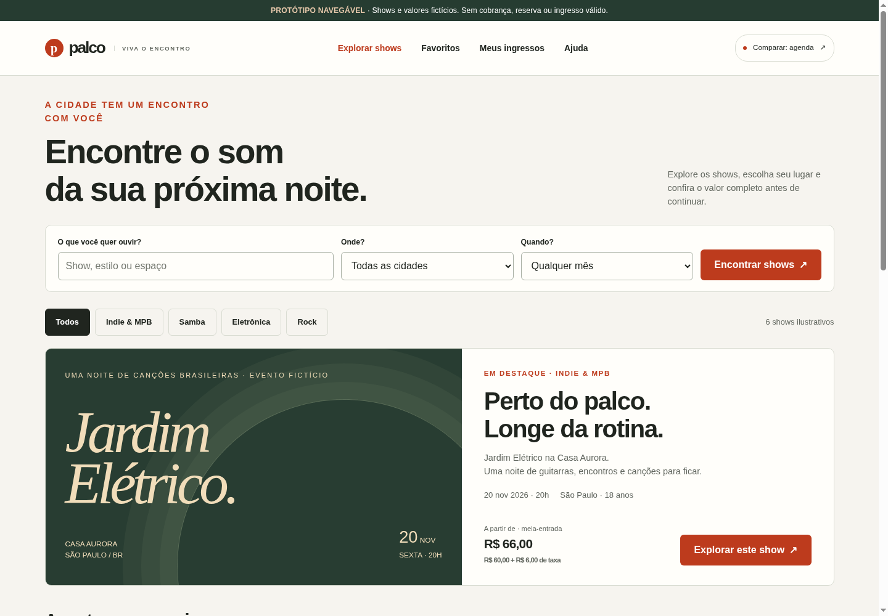

# Palco — esboço navegável de bilheteria

**Protótipo de experiência, não uma bilheteria operacional.** Eventos, espaços, datas e valores são fictícios. Não há cobrança, estoque, conta, envio de e-mail, QR válido, leitura de câmera ou integração financeira. Nenhuma segurança transacional foi implementada ou comprovada por esta interface.

## Prévia visual



[Ver também a captura da agenda direta](docs/preview-agenda.png).

## Abrir e comparar

- **Descoberta editorial:** `public/index.html` → rota `/` após publicar.
- **Agenda direta:** `public/agenda/index.html` → rota `/agenda/`.
- Ambos os HTMLs são independentes, com CSS e JavaScript embutidos, sem CDN, fontes remotas ou pacote JavaScript para instalar.
- No topo há um botão para alternar a direção visual. Os estados locais não são compartilhados entre as duas páginas.

## O que é possível experimentar

1. Buscar por show, espaço ou estilo; filtrar cidade, mês e gênero.
2. Salvar favoritos apenas na memória da página; explorar a lista vazia.
3. Abrir detalhes, ver classificação, local, regras e acessibilidade ilustrativa.
4. Escolher inteira/meia, até seis ingressos; conferir preço e taxa de exemplo de 10% antes de continuar.
5. Conferir checkout sem cadastro obrigatório. Campos pessoais bloqueados e fictícios.
6. Alternar Pix/cartão **como opções de interface, não integrações**.
7. Escolher explicitamente o cenário pendente, aprovado, recusado ou expirado.
8. Abrir um ingresso sem validade e testar primeira/repetida leitura em memória.
9. Consultar ajuda, privacidade e limites de segurança.

Não existem contagem regressiva, disponibilidade ou escassez falsas. Não são geradas chaves Pix ou códigos de entrada. Recarregar limpa toda a simulação.

## Publicar o esboço na Vercel

1. **Add New → Project → importar `lroseno932/bilheteria-shows-mvp`.** Autorize acesso ao repositório na integração GitHub da sua própria conta Vercel.
2. Confira os campos abaixo. O arquivo `vercel.json` já declara o diretório de saída e os cabeçalhos.

```text
Framework Preset: Other
Root Directory: . (raiz do repositório)
Build Command: Override ligado, campo vazio — sem build na Vercel
Output Directory: public
Install Command: nenhum necessário — sem package.json/dependências
Environment Variables: nenhuma
Production Branch: main
```

3. Clique **Deploy**.
4. Abra `/` e `/agenda/`. Teste busca, checkout simulado e ingresso sem validade no domínio publicado.
5. Confira os cabeçalhos HTTP, especialmente `Content-Security-Policy`. Não remova o aviso de protótipo para vender ingressos reais.

**Não é preciso token GitHub como variável na Vercel.** A conexão entre a sua conta Vercel e o repositório é feita pela integração da plataforma. Domínio próprio é opcional para a demonstração. O deploy na conta Vercel é uma etapa do usuário; o repositório não cria nem ativa um projeto Vercel automaticamente.

Referência: https://vercel.com/docs/builds/configure-a-build

## Rodar localmente

Abra um dos HTMLs diretamente no navegador, ou use Python 3:

```sh
python3 scripts/serve.py --port 8794
```

Acesse `http://localhost:8794` e `http://localhost:8794/agenda/`. O servidor local aplica os cabeçalhos de `vercel.json`; deve ser usado apenas para prévia, não para produção.

## Editar e regenerar

- `src/template.html`: estrutura comum e texto.
- `src/prototype.css`: duas composições e responsividade.
- `src/prototype.js`: dados fictícios e estados de interface.
- `scripts/build.py`: gera os dois HTMLs e a política CSP baseada no hash real do JavaScript.

```sh
python3 scripts/build.py
node --check src/prototype.js
python3 -m unittest discover -s tests -v
```

Depois, envie **os HTMLs gerados e `vercel.json`** ao GitHub. Não é necessário executar Python no build da Vercel. Se mudar o JavaScript gerado manualmente sem regenerar a configuração, a política CSP pode bloquear sua execução.

## Cabeçalhos do protótipo

A configuração inclui CSP com hash do script, `connect-src 'none'`, bloqueio de enquadramento, MIME sniffing e acesso a câmera/microfone/geolocalização/pagamento. Estilos inline são permitidos para manter os artefatos portáteis. Isso reduz superfícies deste esboço; **não substitui** autorização, validação de pagamentos, segurança do backend, análise de escopo PCI, auditoria ou operação segura. Na produção a política precisa ser redesenhada para os provedores e recursos efetivamente usados.

## Documentos

- [Comparação visual](docs/DIRECOES-VISUAIS.md).
- [Produto, arquitetura proposta e segurança](docs/PRODUCAO-E-SEGURANCA.md).
- [Critérios de aceite para operação real](docs/CRITERIOS-DE-ACEITE.md).
- [Verificação do protótipo](docs/VERIFICACAO.md).

## Premissas a confirmar

Proposta inicial: Brasil, real, um organizador, setores de entrada geral, Pix/cartão por um futuro provedor, portaria online. Não são requisitos fechados. Antes do desenvolvimento transacional, confirmar quem vende/recebe, se há vários organizadores, assentos numerados, regras de meia-entrada, conectividade de portaria, reembolso e conciliação.

**Segurança total não é uma promessa possível.** O objetivo deve ser reduzir riscos, tornar controles verificáveis e estabelecer monitoramento e resposta a incidentes antes de processar dinheiro real.
